<div align="center">


# Wensenlijst

**Self-hosted wish lists with secret claiming.**<br>
Share one link, and family and friends tick off what they're buying. You never see what's been claimed.


[Features](#-features) · [Screenshots](#-screenshots) · [Quick start](#-quick-start) · [Configuration](#%EF%B8%8F-configuration) · [Security](#-security) · [Development](#-development)

<br>

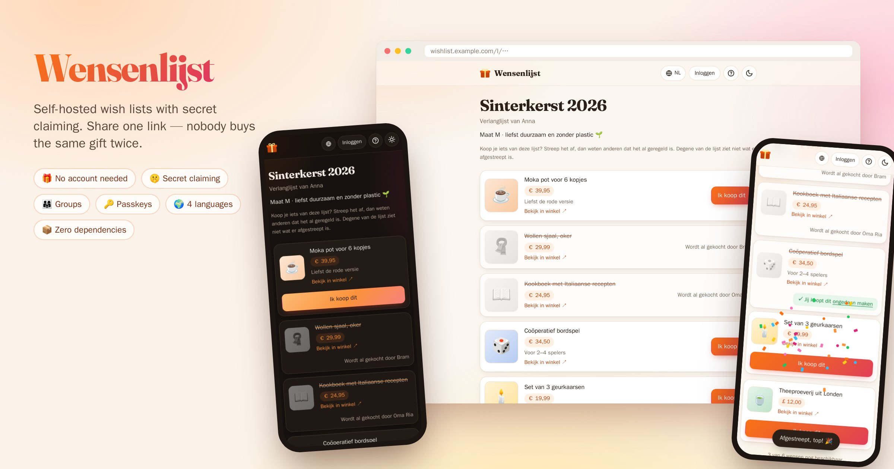

</div>

---

## ✨ Features

<table>
<tr>
<td width="50%" valign="top">

### 🎁 Lists without accounts
Create a list and you get a public **share link** and a secret **edit link**. No sign-up, no e-mail, nothing to install.

### 🤫 Secret claiming
Guests click *"Ik koop dit"* and enter their name.
- **Other givers** see it, so nobody buys the same gift twice.
- **The list owner** doesn't see it.
- **The guest** can undo it from the same device.

### 🔗 Product auto-fill
Paste a shop link and the name, price, image and currency fill themselves in:
- read from JSON-LD and OpenGraph;
- a dedicated Amazon parser;
- a beslist.nl fallback.

</td>
<td width="50%" valign="top">

### 👨‍👩‍👧 Groups
One link for the whole family's lists. Anyone with the link can add their own list, and a list can be in several groups. A group can have an optional password.

### 🔑 Optional accounts and passkeys
Sign up with a password or with a **passkey**, and your lists follow you to every device. Accounts also have:
- e-mail password reset;
- a pairing code for computers without Bluetooth;
- "log out everywhere".

### 🌍 Four languages, two themes
- **Languages:** Dutch, English, French and German. E-mails go out in the user's language.
- **Look:** light and dark mode, animations and confetti, all respecting *reduce motion*.

</td>
</tr>
</table>

**Also included:**
- an admin page (admin is a role on a normal account) with SMTP settings and a test mail;
- link previews for WhatsApp and similar apps;
- a FAQ page;
- strict security defaults;
- one SQLite file to back up;
- **0 npm dependencies**.

## 📸 Screenshots

<table>
<tr>
<td align="center" width="33%">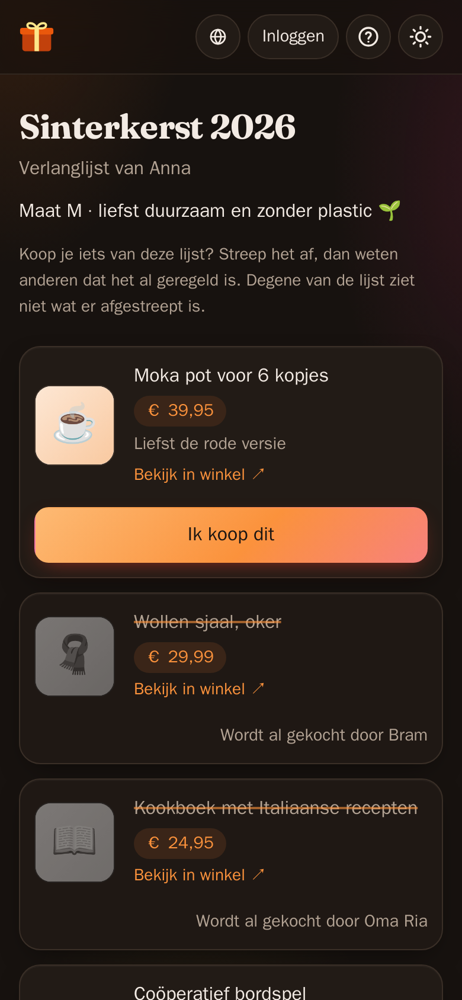<br><sub><b>A shared list</b> (dark mode)</sub></td>
<td align="center" width="33%">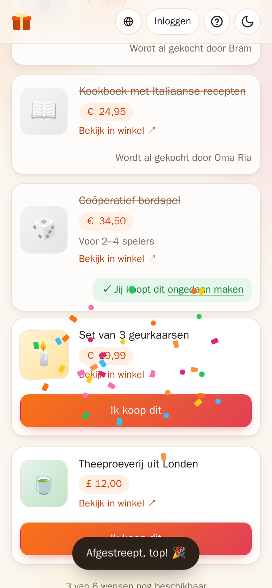<br><sub><b>Claiming a gift</b> 🎉</sub></td>
<td align="center" width="33%">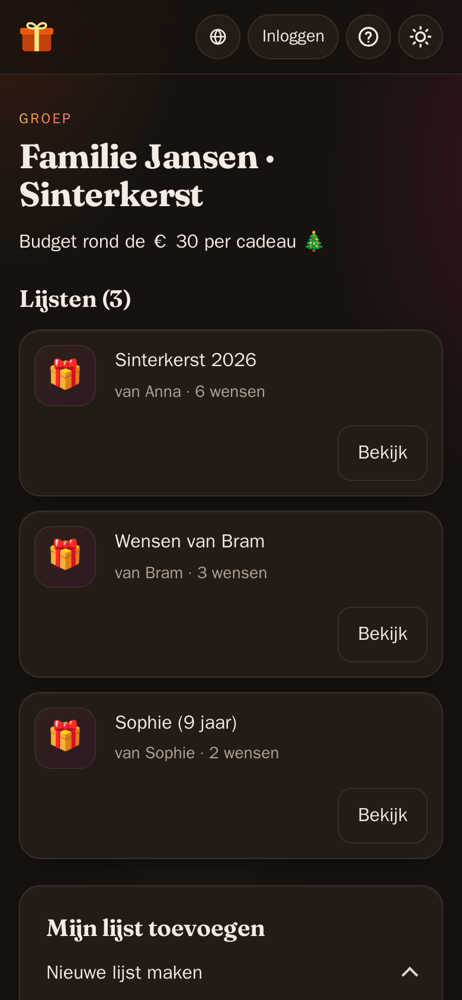<br><sub><b>A family group</b></sub></td>
</tr>
<tr>
<td align="center">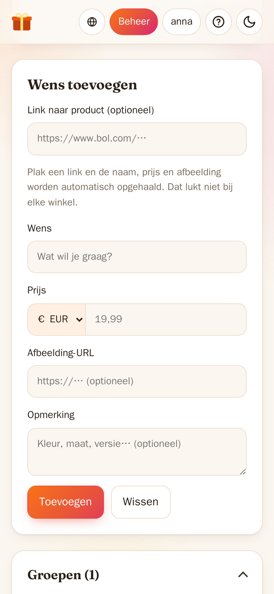<br><sub><b>Adding a wish</b>: paste a link and it auto-fills</sub></td>
<td align="center">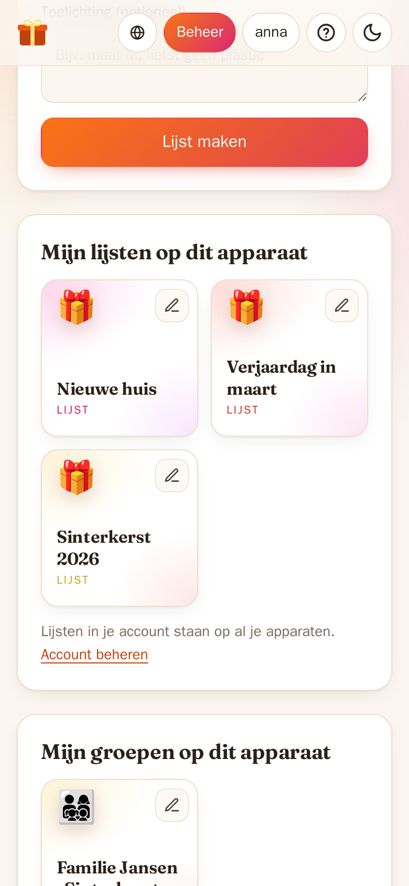<br><sub><b>Your lists and groups</b></sub></td>
<td align="center">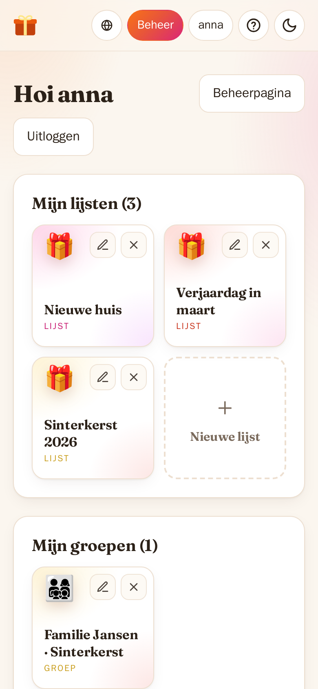<br><sub><b>Optional account</b></sub></td>
</tr>
<tr>
<td align="center">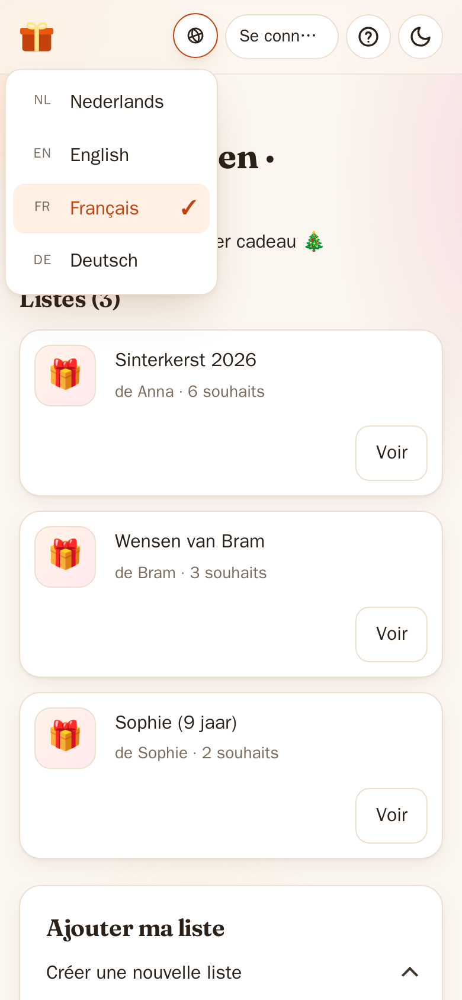<br><sub><b>Four languages</b></sub></td>
<td align="center">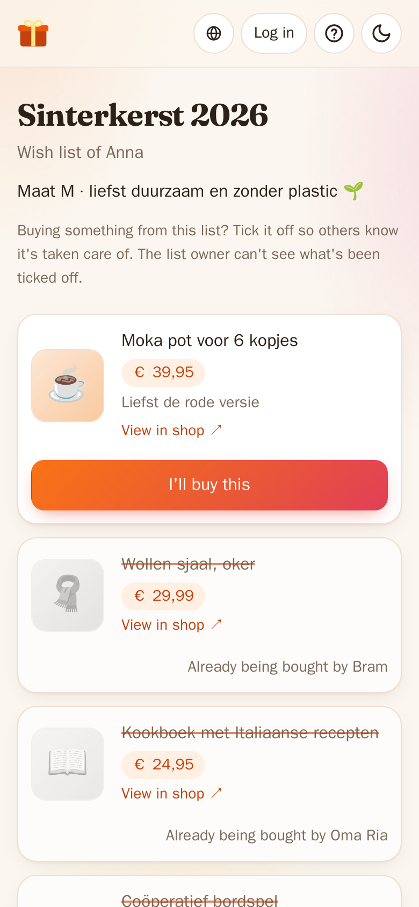<br><sub><b>…the same list, in English</b></sub></td>
<td align="center">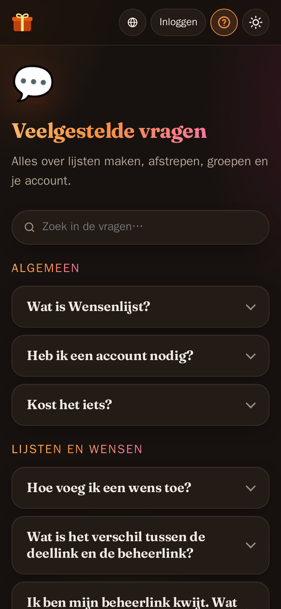<br><sub><b>Built-in FAQ</b></sub></td>
</tr>
</table>

<details>
<summary><b>Admin page</b> (desktop, dark mode)</summary>
<br>
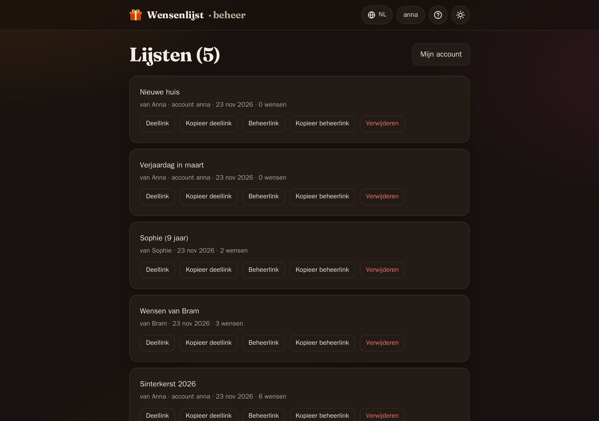
</details>

## 🚀 Quick start

```sh
git clone https://github.com/RyberNL/wensenlijst.git && cd wensenlijst
docker build -t wensenlijst .
docker run -d --name wensenlijst --restart unless-stopped \
  -p 127.0.0.1:3280:3000 \
  -e ORIGIN=https://wishlist.example.com \
  -v wensenlijst-data:/data \
  wensenlijst
```

Put a reverse proxy with TLS in front of it. With Caddy that's three lines:

```caddyfile
wishlist.example.com {
  reverse_proxy 127.0.0.1:3280
}
```

Prefer Compose? See [`docker-compose.example.yml`](docker-compose.example.yml).

<details>
<summary><b>Without Docker</b></summary>

You need Node.js **22.13 or newer** (for the built-in `node:sqlite`):

```sh
ORIGIN=http://localhost:3000 node --disable-warning=ExperimentalWarning server.js
```
</details>

### 👑 Becoming admin

While no admin exists, the server prints a **one-time setup code** to its log:

```sh
docker logs wensenlijst
# [admin] Nog geen beheerder. Log in op /account en vul op /admin deze eenmalige setupcode in: 12345678
```

Then:
1. Create an account on `/account`.
2. Open `/admin` and enter the code.
3. From then on you can promote other accounts on the admin page.

## ⚙️ Configuration

| Variable | Default | Description |
|---|---|---|
| `ORIGIN` | *(empty)* | The public URL, e.g. `https://wishlist.example.com`. **Set this in production**: it drives the cross-site request check, the passkey relying party, links in e-mails and HSTS. |
| `PORT` | `3000` | The HTTP port. |
| `DB_PATH` | `/data/wensen.db` | Path to the SQLite database. |
| `SMTP_HOST` · `SMTP_PORT` | — | Mail server. E-mail is optional and only used for password reset and notices. |
| `SMTP_SECURE` | `starttls` | Either `none`, `starttls` or `tls`. |
| `SMTP_TLS_VERIFY` | `true` | Set to `false` for a local relay with a self-signed certificate. |
| `SMTP_USER` · `SMTP_PASS` | — | Optional SMTP login. |
| `SMTP_FROM` · `SMTP_FROM_NAME` | — · `Wensenlijst` | The sender address and name. |

> [!TIP]
> SMTP settings can also be changed on the admin page, which overrides the environment. The admin page also has a test-mail button.

> [!NOTE]
> **Backups:** everything lives in one SQLite file. Make a consistent copy while the app is running with `sqlite3 wensen.db ".backup backup.db"`.

## 🔒 Security

- **🔑 Secrets**
  - Edit links, claim tokens and sessions are random tokens.
  - Sessions and reset tokens are stored only as hashes.
  - Passwords use **scrypt**.
- **🪪 Passkeys** are verified without dependencies:
  - the public key is SPKI from `getPublicKey()`, so there's no CBOR parsing;
  - challenge, origin, rpId, user verification and the signature counter are all checked.
- **🛡️ Browser hardening**
  - a strict CSP with no inline scripts;
  - `Referrer-Policy: no-referrer`, so edit tokens never leak to shops;
  - SameSite=Strict cookies, HSTS, and an Origin check on API writes.
- **🌐 SSRF-safe product fetching**
  - every DNS answer is checked against private and reserved ranges;
  - redirects are re-validated;
  - responses are size-capped, also after decompression.
- **⏱️ Rate limits** apply to logins, sign-ups, resets, claims and pairing codes.

> [!IMPORTANT]
> Rate limits use the first `X-Forwarded-For` address, so **only expose the app through your reverse proxy** (bind it to `127.0.0.1`).

> [!NOTE]
> Hiding claims from the owner is a social feature, not a security boundary. An owner who really wants to peek can open their own share link in a private window.

## 🛠 Development

No build step and nothing to install: edit a file and restart.

```
server.js        HTTP server · lists, items, claims, groups · product fetching · page shell & link previews
user-api.js      optional accounts · passwords, passkeys, pairing codes, password reset
admin-api.js     admin endpoints (users with is_admin = 1)
auth-lib.js      shared scrypt · cookie sessions · WebAuthn verification
mailer.js        tiny SMTP client (plain / STARTTLS / TLS, AUTH PLAIN/LOGIN)
public/
  app.js         all user-facing pages (vanilla JS)
  admin.js       admin page
  i18n-dict.js   translations: [nl, en, fr, de] rows keyed by the Dutch text, also used for e-mails
  i18n.js        language menu + automatic translation of fixed UI text
  style.css      light/dark theme and animations
```

### 🌍 Adding UI text

The code is written in Dutch, and the Dutch text is the translation key:
- **Fixed texts** are translated automatically when they appear on the page.
- **Texts with variables** use `t('Hoi {0}', name)`.
- **Every new text** needs a row in `public/i18n-dict.js` with English, French and German. Without one, it simply stays Dutch.

## 📄 License

[MIT](LICENSE). The bundled [Fraunces](https://github.com/undercasetype/Fraunces) font is licensed under the SIL Open Font License.

<div align="center"><br><sub>Made with 🧡 for families who are tired of receiving three identical scarves.</sub></div>
